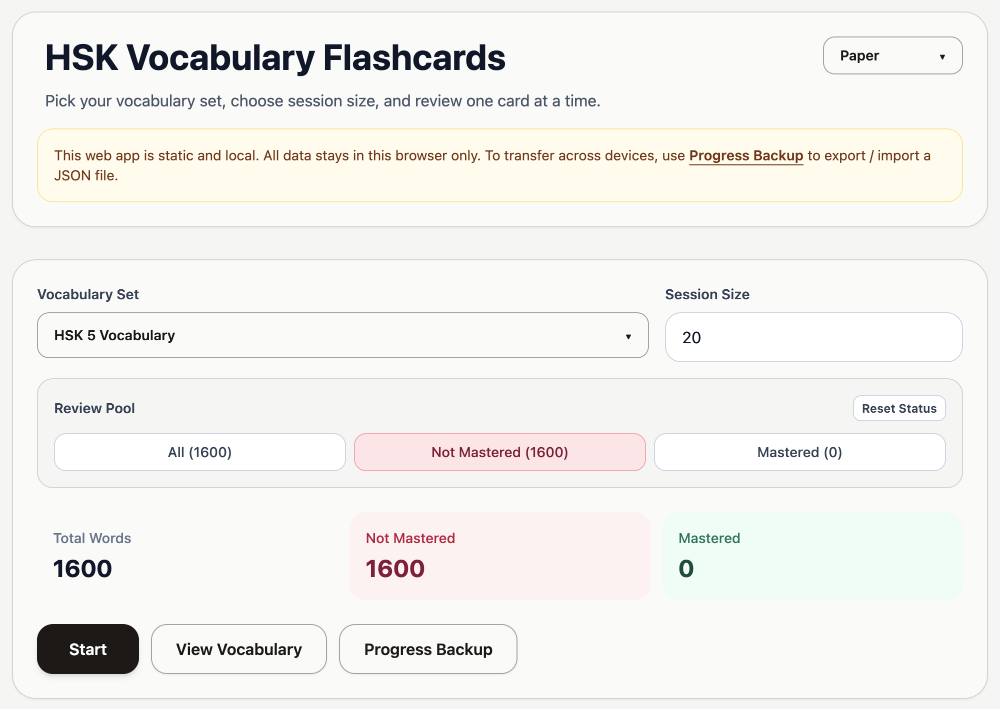
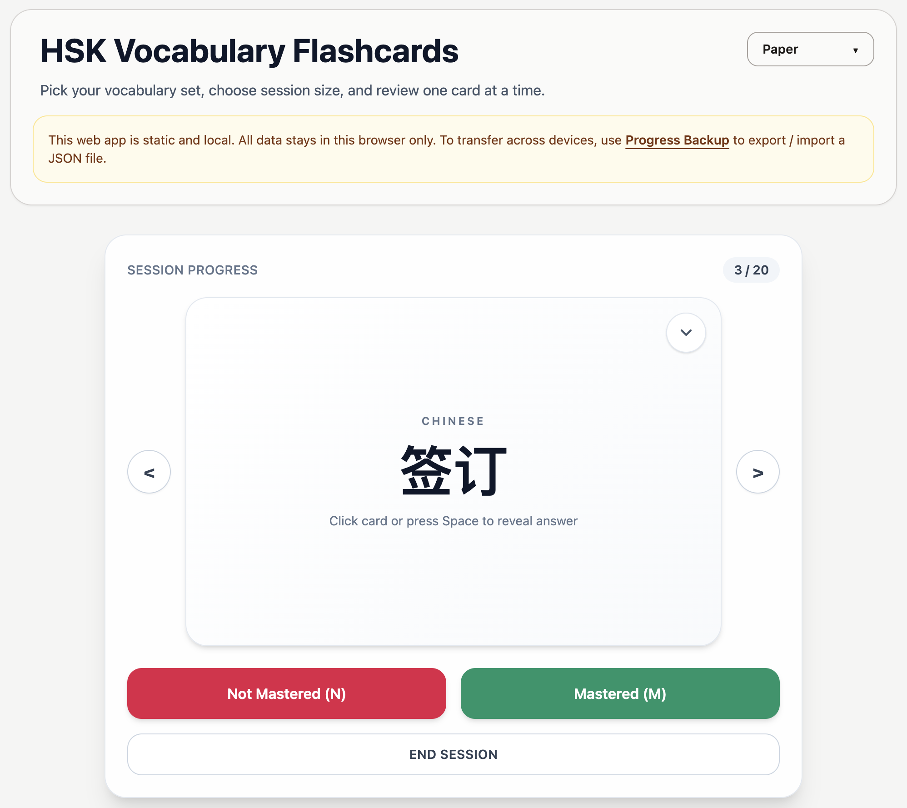
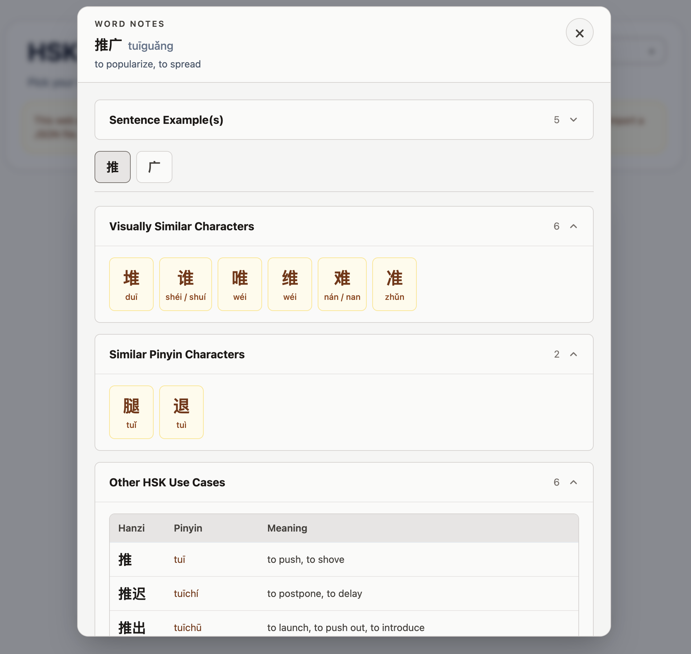

# HSK Vocabulary Flashcards

A web-based flashcard app to review HSK 1–5 vocabulary with progress tracking.

[leviathan121005.github.io/hsk-vocabulary-flashcards](https://leviathan121005.github.io/hsk-vocabulary-flashcards/)

<p>
  
</p>

## Features

- **Flashcard sessions**: select a vocabulary set, mastery pool, and session size to review
- **Self-mastery tracking**: mark each word as `Mastered` or `Not Mastered` by personal assessment
- **Vocabulary lookup**: search words and set their mastery manually
- **Word and character info**: support memorization with example sentences, per-character definitions, visually similar characters, characters with the same pinyin, and other uses of the character in HSK words
- **Word audio**: verify pronunciation

<p>
  
</p>
<p>
  
</p>

## 1. Clone the Repository

```bash
git clone https://github.com/Leviathan121005/hsk-vocabulary-flashcards.git
cd hsk-vocabulary-flashcards
```

## 2. Install and Run Locally

```bash
npm install
npm run dev
```

Open the local URL shown in the terminal.

## 3. Build and Preview

```bash
npm run build
npm run preview
```

## 4. Notes

- Frontend-only, with no account login or cloud sync.
- Visually similar characters are precomputed offline by combining SSIM, a pretrained MobileNetV3-Small, Ideographic Description Sequence (IDS) component decomposition, and a stroke-count filter.
- Progress is stored in browser `localStorage` and can be exported or imported as a backup. It is recommended to back up progress periodically as browsers may clear site data which resets progress.

## References

**Data sources**
- [MandarinBean](https://mandarinbean.com/): HSK word lists
- [Make Me a Hanzi](https://github.com/skishore/makemeahanzi): character decompositions and stroke counts
- [HSK Annotated Corpus](https://github.com/Roxaleen/hsk-annotated-corpus): example sentences

**Built with** React, Vite, Tailwind CSS, PyTorch, torchvision, scikit-image